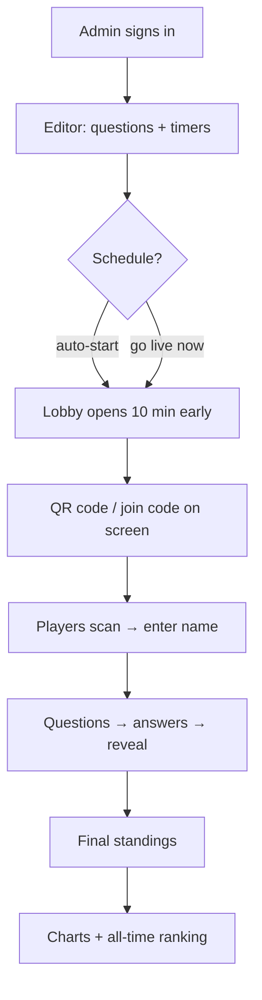

# Trivyo — frontend

Interface for live MCQ tests, built on [trivyo-online/backend](https://github.com/trivyo-online/backend).

The look is monochrome retro: a near-black background, warm off-white type and a particle field that changes shape for each section. It also uses a high-contrast serif for display text, monospace labels, dashed chips and a film-grain overlay.

## Run

```bash
npm install
cp .env.example .env   # VITE_API_URL → the Go server (default http://localhost:8080)
npm run dev
```

`npm run build` type-checks and builds to `dist/`. It needs the backend running with MongoDB; see the backend README.

## What's in it

| Step | Route | What it does |
|---|---|---|
| A | `#/intro` | Landing page |
| B | `#/join?room=CODE` | Room code + name. Scanning a room's QR code opens this with the code filled in. For a scheduled test it waits and goes in automatically when the lobby opens |
| — | `#/play` | Player screen: questions with a countdown, instant result, reveal, live ranking, final standings |
| C | `#/admin` | Admin sign-in / sign-up and an events dashboard (Edit · Go live · QR · Results · Delete) |
| — | `#/editor?room=` | Question editor: add, remove, reorder and copy questions; 2–6 options; mark the answer; per-question timer; scheduled start with auto-start; Ctrl/⌘+S |
| — | `#/live?room=` | Host console: QR code and join code, player list, Start test, Reveal, Next, Auto-run, End, a live answer-distribution chart and the live ranking |
| D | `#/practice` | Offline timed practice |
| E | `#/ranks` | All-time ranking and recent rooms. `?room=` shows a room's standings, accuracy per question and how each question was answered |



## Built for poor networks

- **Auto-reconnect.** Retries use exponential backoff with jitter, retry immediately when the device comes back online or the tab becomes visible again, and give up with a clear reason if the room has ended or the name is taken.
- **Nothing is lost on a drop.** An answer given while offline is kept and sent on reconnect. The server sends back your score, the open question with the exact time left, and your earlier answer. Repeats never score twice.
- **Clear status.** A banner says "Offline" or "Reconnecting · your answers and score are safe".
- **Timers use the server's clock,** so a wrong phone clock or a slow frame doesn't change the countdown.
- **Small downloads.** Pages load on demand: a player downloads about 75 KB of gzipped JS for the shell plus a few KB per page. The server compresses socket frames and JSON.
- **Each browser has a private rejoin key,** so a refresh keeps your name and nobody else can take it.

Keyboard: `1`–`4` or `A`–`D` answers. The wave button in the bottom-right corner pauses the background motion. The app also respects `prefers-reduced-motion`.
